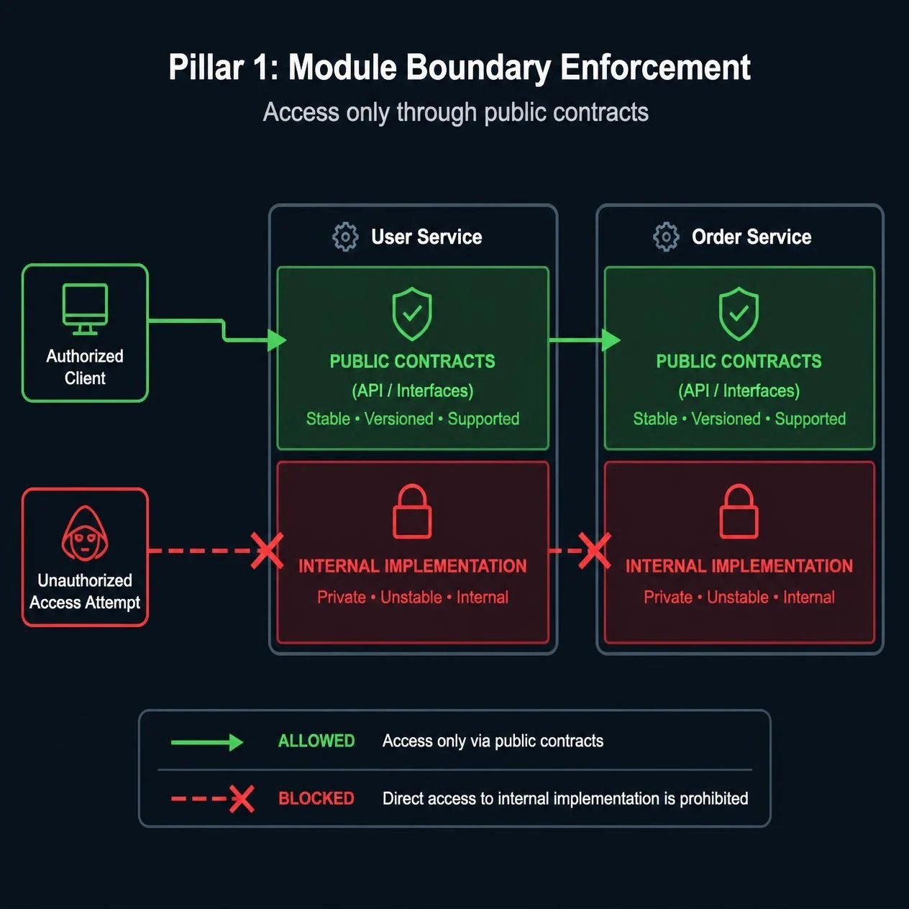
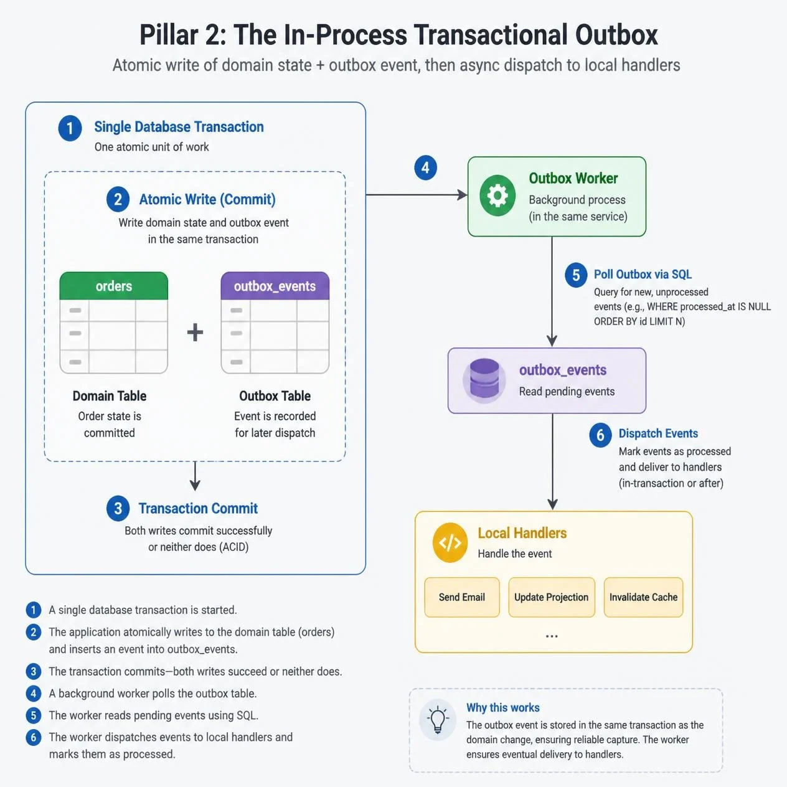
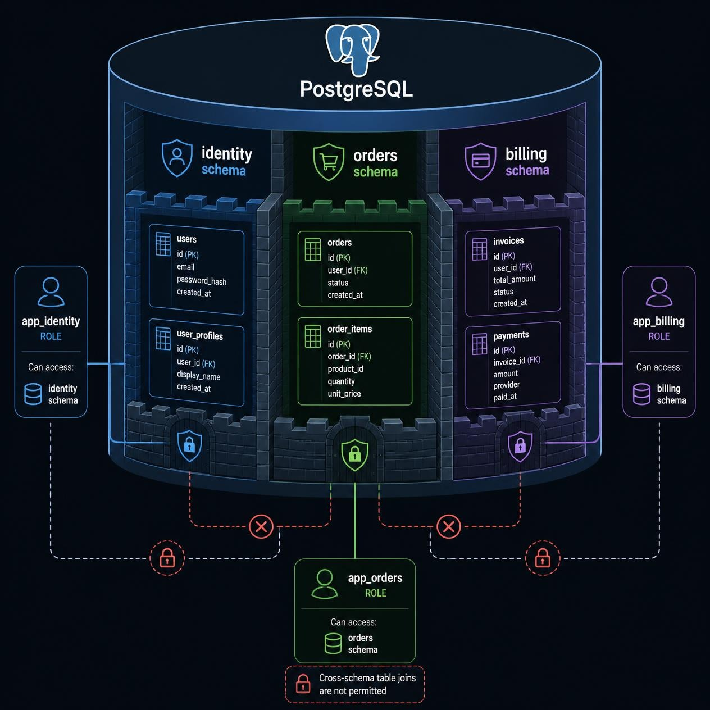

# Sanity at Scale (Part 2): Automating Architectural Discipline

In Part 1, we laid out the decision framework for the modular monolith: keep deployments unified, isolate domains in code, and avoid the operational overhead of microservices until a specific scaling or compliance bottleneck forces your hand.

On paper, everybody agrees with the Three Pillars: strict domain boundaries, in-process communication, and data isolation. Every team starts a new repository with the best intentions of keeping modules clean, until a Friday deadline hits.

When an engineer is racing to ship a hotfix, or when an AI assistant auto-completes an import, they take the shortest path that compiles. If `billing` needs a user's email, someone will eventually import `UserRepository` directly from `identity`. The tests pass. The PR merges because nobody reads 40 lines of imports at the top of a diff. Six months later, you have a Big Ball of Mud.

This is why I opened Part 1 with [Gerard Holzmann’s "Power of Ten" rules from NASA’s Jet Propulsion Laboratory](https://youtu.be/GRJtYwneG2Q?si=qwMECZhF2zsvEEjD). NASA kept their flight software reliable by enforcing a zero-warning culture where static analysis broke the build the moment a rule was crossed, rather than writing guidelines in a wiki and hoping engineers remembered them during code reviews.

## Why "Zero Warnings" Is Binary

When teams introduce an architectural linter, the instinct is to set the rule to `warn` first so it doesn't block developers. In my experience, that guarantees the rule will fail:

* **1 to 3 warnings:** Engineers notice them and might clean one up.
* **15 warnings:** Nobody knows which warning belongs to their PR. Everyone stops reading the terminal output.
* **200+ warnings:** The linter is dead. A critical boundary violation scrolls past inside a wall of yellow text, and the PR merges anyway.

In a living codebase, the only two stable states for warnings are **zero** or **hundreds**.

If an architectural rule doesn't return a non-zero exit code (`severity: 'error'`), you are training your team to ignore the terminal. What if you are retrofitting an existing codebase that already has 50 boundary violations? Do not set the linter to `warn`. Instead, record a baseline of existing violations (`--ignore-known` in `dependency-cruiser`, or `ignore_imports` in `import-linter`) so CI fails on any *new* violation while you burn down the old ones. And add a single canary test containing a deliberate violation that asserts the linter fails, so a misconfigured CI script never goes unnoticed.

Here is how to enforce the Three Pillars across TypeScript, Python, and Go.



## 1. Enforcing Strict Boundaries

Code inside `billing` cannot import the internal models, repositories, or services of `identity`. Every module must be treated like an external package.

### Avoiding Barrel Files (`index.ts` / `__init__.py`)

The standard advice for encapsulating a module is placing a barrel file at the root of each domain to re-export public classes. As [Dominik Dorfmeister (TkDodo) detailed](https://tkdodo.eu/blog/please-stop-using-barrel-files), barrel files break at scale for two reasons:

1. **Circular Imports:** If `identity/auth.service.ts` needs a helper from `identity/hash.ts`, your editor can auto-import it via the barrel file (`../index.ts`). Because `index.ts` also re-exports `auth.service.ts`, you create an import loop (`auth.service` $\rightarrow$ `index` $\rightarrow$ `auth.service`) that can evaluate to `undefined` at runtime.
2. **Module Graph Overhead:** Importing a single DTO from an unoptimized barrel file forces the runtime or test runner to parse every other module re-exported by that barrel, pulling controllers, ORM entities, and database connections into memory when a unit test only needed a type definition.

### Using `public/` Directories and CI Linters

Skip barrel re-exports (in Python, keep `__init__.py` files empty). Split each domain module into `public/` (interfaces, DTOs, DI tokens, events) and `internal/` (entities, repositories, domain logic). Cross-cutting utilities belong in a dedicated `src/shared/` directory that cannot import from `src/modules/`:

```text
src/
├── shared/                     # <-- Cross-cutting primitives (cannot import modules)
└── modules/
    ├── identity/
    │   ├── public/             # <-- Visible to other modules
    │   │   ├── contract.(ts|py|go)
    │   │   └── dto.(ts|py|go)
    │   ├── internal/           # <-- Private to identity
    │   │   ├── entity.(ts|py|go)
    │   │   ├── repository.(ts|py|go)
    │   │   └── service.(ts|py|go)
    │   └── identity.module.ts  # <-- Binds internal service to public DI token
    └── billing/
        └── internal/
            └── invoice_service.(ts|py|go)
```

How does `billing` call `identity` at runtime without importing `identity/internal/service`? Through dependency injection. `identity/public/contract.ts` exports an interface and a DI token (`IDENTITY_CONTRACT`), while `identity.module.ts` binds the internal `IdentityService` to that token:

```typescript
// src/modules/identity/public/contract.ts
export const IDENTITY_CONTRACT = Symbol('IDENTITY_CONTRACT');

export interface IdentityContract {
  getUserBillingProfile(userId: string): Promise<UserBillingProfileDto>;
}

// src/modules/identity/identity.module.ts
@Module({
  providers: [{ provide: IDENTITY_CONTRACT, useClass: IdentityService }],
  exports: [IDENTITY_CONTRACT],
})
export class IdentityModule {}
```

Now `BillingService` injects `@Inject(IDENTITY_CONTRACT) private identity: IdentityContract` by importing only from `identity/public/contract`.

#### TypeScript / NestJS (`dependency-cruiser`)

Rather than a blocklist that only catches `internal/`, use an allowlist so cross-module imports can *only* target `public/` (or the module registration file at the root of the module). Add `.dependency-cruiser.cjs` and run `npx depcruise src --config .dependency-cruiser.cjs` in CI:

```javascript
// .dependency-cruiser.cjs
module.exports = {
  forbidden: [
    {
      name: 'cross-module-must-use-public',
      comment: 'Cross-module imports may only target another module\'s public/ directory or module definition.',
      severity: 'error',
      from: { path: '^src/modules/([^/]+)/' },
      to: {
        path: '^src/modules/([^/]+)/',
        pathNot: [
          '^src/modules/$1/',                         // Allow imports within the same module
          '^src/modules/[^/]+/public/',               // Allow imports from another module's public/
          '^src/modules/[^/]+/[^/]+\\.module\\.ts$',  // Allow NestJS module wiring
        ],
      },
    },
    {
      name: 'shared-cannot-import-modules',
      comment: 'Shared kernel code cannot depend on domain modules.',
      severity: 'error',
      from: { path: '^src/shared/' },
      to: { path: '^src/modules/' },
    },
    {
      name: 'no-circular-dependencies',
      severity: 'error',
      from: {},
      to: { circular: true },
    },
  ],
};
```

*(If your team already uses Nx or ESLint, `@nx/enforce-module-boundaries` and `eslint-plugin-boundaries` enforce the same rules directly in ESLint.)*

#### Python / FastAPI & Django (`import-linter`)

In Python, define one contract per module's `internal` package so a module can freely import its own `internal` code while other modules are blocked. Add this to `pyproject.toml` and run `lint-imports` in CI:

```toml
# pyproject.toml
[tool.importlinter]
root_package = "src"

[[tool.importlinter.contracts]]
name = "Identity internal is private"
type = "forbidden"
source_modules = ["src.modules.billing", "src.modules.orders", "src.shared"]
forbidden_modules = ["src.modules.identity.internal"]

[[tool.importlinter.contracts]]
name = "Billing internal is private"
type = "forbidden"
source_modules = ["src.modules.identity", "src.modules.orders", "src.shared"]
forbidden_modules = ["src.modules.billing.internal"]

[[tool.importlinter.contracts]]
name = "Orders internal is private"
type = "forbidden"
source_modules = ["src.modules.identity", "src.modules.billing", "src.shared"]
forbidden_modules = ["src.modules.orders.internal"]
```

#### Go (Native `internal/` Compiler Rule)

Go doesn't need a third-party linter for package privacy. The Go compiler blocks any package from importing an `internal/` directory unless the importer is rooted in the parent directory of that `internal/` tree:

```go
// File: src/modules/billing/internal/invoice_service.go
package internal

import (
    // COMPILES
    "github.com/myorg/monolith/src/modules/identity/public"

    // COMPILER ERROR: use of internal package not allowed
    "github.com/myorg/monolith/src/modules/identity/internal"
)
```

## 2. In-Process Communication

Import linters fix build-time coupling, while runtime coupling requires a different approach. If `OrderService` calls `BillingService.chargeCard()` and `NotificationService.sendEmail()` synchronously inside an HTTP request, your modules are chained together. When the email provider times out, checkout fails.

To decouple domains without deploying Kafka or RabbitMQ on day one, use an **In-Process Event Bus**.

### Why Raw In-Memory Emitters Fail

Firing an event directly into memory (`EventEmitter` in Node, `blinker` in Python, or a Go channel) right after a database write introduces a dual-write bug:

```typescript
// Dual-write bug
async placeOrder(dto: CreateOrderDto) {
  const order = await this.orderRepo.save(dto); 
  // If the container restarts or OOMs here, the event is lost forever
  await this.eventBus.emitAsync('order.placed', new OrderPlacedEvent(order.id));
  return order;
}
```

If Postgres commits on line 1 and the container restarts before line 2 finishes, the order exists in the database, but `Billing` and `Inventory` never know it happened.

### Using an In-Process Transactional Outbox

Write both the domain state and the event to Postgres inside the *same* database transaction. To stay consistent with strict schema isolation (Section 3), each module owns its own outbox table (`orders.outbox_events`) inside its schema, so `OrderService` commits both rows using its own database role.

#### TypeScript (NestJS / TypeORM)

```typescript
// src/modules/orders/internal/order.service.ts
@Injectable()
export class OrderService {
  constructor(private readonly ordersDb: DataSource) {}

  async placeOrder(dto: CreateOrderDto): Promise<OrderDto> {
    return await this.ordersDb.transaction(async (manager) => {
      const order = await manager.save(OrderEntity, {
        userId: dto.userId,
        totalCents: dto.totalCents,
        status: 'PENDING',
      });

      // Stored in orders.outbox_events in the same transaction
      await manager.save(OrdersOutboxEntity, {
        id: randomUUID(),
        topic: 'orders.order_placed.v1',
        payload: { orderId: order.id, userId: order.userId, totalCents: order.totalCents },
        status: 'PENDING',
        attempts: 0,
      });

      return { id: order.id, status: order.status };
    });
  }
}
```

#### Python (FastAPI / SQLAlchemy Async)

```python
# src/modules/orders/internal/service.py
# Configure async_sessionmaker(expire_on_commit=False) so returned attributes stay accessible
class OrderService:
    def __init__(self, session: AsyncSession):
        self.session = session

    async def place_order(self, user_id: str, total_cents: int) -> OrderDto:
        order = OrderModel(user_id=user_id, total_cents=total_cents, status="PENDING")
        self.session.add(order)
        await self.session.flush()

        self.session.add(OrdersOutboxModel(
            id=uuid4(),
            topic="orders.order_placed.v1",
            payload={"order_id": str(order.id), "user_id": user_id, "total_cents": total_cents},
            status="PENDING",
            attempts=0,
        ))
        await self.session.commit()
        return OrderDto(id=order.id, status=order.status)
```

### Production Rules for the Outbox Worker

A background worker polls committed rows where `status = 'PENDING'` and dispatches them. To keep this reliable in production, follow four rules:

1. **At-Least-Once Delivery and Idempotent Handlers:** If a worker crashes after running a handler but before marking the row `PROCESSED`, the event will be delivered again. Every subscriber must be idempotent, deduplicating by `event_id` in a `processed_events` inbox table or using an idempotent upsert.
2. **Claim First, Don't Hold Locks Across Handlers:** Use `SELECT ... FOR UPDATE SKIP LOCKED` only inside a short transaction that sets `status = 'PROCESSING'` and `locked_until = now() + interval '30 seconds'`, then commits immediately. Run the handler *outside* that transaction so slow handlers don't hold database row locks or connections open.
3. **Retries, Poison Messages, and Cleanup:** Increment `attempts` on failure with exponential backoff (`next_attempt_at`). Move rows that exceed `max_attempts` to `status = 'DEAD_LETTER'` with an alert, and run a daily job to prune old `PROCESSED` rows.
4. **Ordering:** `SKIP LOCKED` across multiple workers does not preserve per-aggregate order. Include a `version` or timestamp in the event payload so subscribers can ignore out-of-order events.

If you later extract `Billing` into its own microservice, the **write path inside `OrderService` doesn't change**. You update the outbox worker to publish `orders.order_placed.v1` to EventBridge or RabbitMQ instead of invoking the in-process handler.



## 3. Data Isolation

Code linters and outboxes won't save you if all your tables sit in Postgres's default `public` schema. The first time a developer writes a SQL `JOIN` across `billing_invoices` and `identity_users` to close a ticket fast, your modules are welded together at the storage layer.

### Postgres Schemas and Role Permissions

A single Postgres instance supports **logical schemas**, giving you isolated namespaces without spinning up separate database instances.

1. **One Schema Per Module:** Every module owns its schema (`identity.*`, `orders.*`, `billing.*`). Lock down the default `public` schema so nothing gets created there accidentally.
2. **No Cross-Schema Foreign Keys:** Store `user_id` as a plain `UUID` column, never as `REFERENCES identity.users(id)`. Because you give up database-level cascading deletes, handle account deletion explicitly via domain events (such as `identity.user_deleted.v1`) and periodic reconciliation jobs.
3. **Default-Deny Database Roles:** Give each module its own runtime role with least-privilege DML access (`SELECT, INSERT, UPDATE, DELETE`) restricted to its own schema, while a separate migration role owns DDL changes:

```sql
-- 1. Lock down the default public schema
REVOKE ALL ON SCHEMA public FROM PUBLIC;

-- 2. Create module schemas owned by the migration role
CREATE SCHEMA IF NOT EXISTS identity AUTHORIZATION migrations_role;
CREATE SCHEMA IF NOT EXISTS billing AUTHORIZATION migrations_role;

-- 3. Create a least-privilege runtime role for the billing module
CREATE ROLE billing_runtime_role WITH LOGIN PASSWORD '...';

GRANT USAGE ON SCHEMA billing TO billing_runtime_role;
GRANT SELECT, INSERT, UPDATE, DELETE ON ALL TABLES IN SCHEMA billing TO billing_runtime_role;

-- Ensure future tables created by migrations in billing are accessible to billing_runtime_role
ALTER DEFAULT PRIVILEGES FOR ROLE migrations_role IN SCHEMA billing
  GRANT SELECT, INSERT, UPDATE, DELETE ON TABLES TO billing_runtime_role;
```

Because Postgres roles are default-deny, `billing_runtime_role` has zero privileges on the `identity` schema. Note that using separate database roles per module means either configuring a small connection pool (`DataSource`) per module behind PgBouncer so you don't exhaust `max_connections`, or using a single pool that scopes permissions per request.

In code, bind every ORM model to its module's schema:

```typescript
// TypeScript (TypeORM) — src/modules/billing/internal/invoice.entity.ts
@Entity({ schema: 'billing', name: 'invoices' })
export class InvoiceEntity {
  @PrimaryGeneratedColumn('uuid')
  id: string;

  @Column({ type: 'uuid' }) // Plain UUID, no foreign key to identity.users
  userId: string;
}
```

```python
# Python (SQLAlchemy) — src/modules/billing/internal/models.py
class InvoiceModel(Base):
    __tablename__ = "invoices"
    __table_args__ = {"schema": "billing"}

    id: Mapped[UUID] = mapped_column(primary_key=True, default=uuid4)
    user_id: Mapped[UUID] = mapped_column(index=True)
```

If `billing` runs `SELECT * FROM identity.users`, Postgres rejects it with `permission denied for schema identity`.



When `billing` needs a user's email and tax ID to generate an invoice without a cross-schema `JOIN`, use one of two patterns:

* **Low-frequency reads (Public Contract):** Call `identityContract.getUserBillingProfile(userId)` in memory.
* **High-frequency reads (Local Projection):** Subscribe to `identity.user_updated.v1` from the outbox and maintain a read-only projection table inside `billing.customer_profiles` (`user_id`, `email`, `tax_id`, `version`). Store a `version` column on the projection so out-of-order events never overwrite newer data, include a CLI script to backfill the projection from `IdentityContract` when needed, and remember that duplicating PII like `tax_id` means `billing.customer_profiles` must also honour GDPR/deletion events.

## The Enforcement Stack

Pair every architectural boundary with an automated check that breaks the build or blocks the query:

| Area | Common Failure | Pattern | TypeScript / Node | Python | Go | Java / C# |
| :--- | :--- | :--- | :--- | :--- | :--- | :--- |
| **1. Boundaries** | Cross-module internal imports, barrel file loops | `public/` vs. `internal/` directories | `dependency-cruiser` / Nx / `eslint-plugin-boundaries` | `import-linter` | Native `internal/` compiler rule | `ArchUnit` / `NetArchTest` |
| **2. Communication** | Synchronous chains, dropped in-memory events | Event Bus + per-module Transactional Outbox | TypeORM / Prisma tx + Idempotent Outbox worker | SQLAlchemy `session.commit()` + Outbox worker | `pgx.BeginTx` + Outbox goroutine | Spring Modulith `@ApplicationModuleListener` |
| **3. Data Isolation** | Cross-domain SQL `JOIN`s and foreign keys | Postgres schemas + local projections | `@Entity({ schema })` + Default-deny DB roles | `__table_args__` schema + Default-deny DB roles | Schema-scoped `search_path` per pool | Flyway multi-schema + Default-deny DB roles |

## Earning the Right to Distribute

Setting up import linters takes an afternoon; wiring a per-module transactional outbox, idempotent handlers, and schema-scoped database roles takes a few days of deliberate engineering. Compare that to the months spent managing service meshes, distributed tracing, and cross-repo deployments for microservices you don't need yet.

When your boundaries are enforced by CI and database permissions, your team and their AI coding tools can ship fast without turning the codebase into spaghetti. And when your traffic or team structure finally hits a real scaling or compliance bottleneck, your data is already isolated and your write path is already publishing events to an outbox. In Part 3, we will walk through the extraction playbook: how to carve a module out of this monolith into an independent service with zero downtime, and how to handle the transition from in-memory contract calls to network APIs.